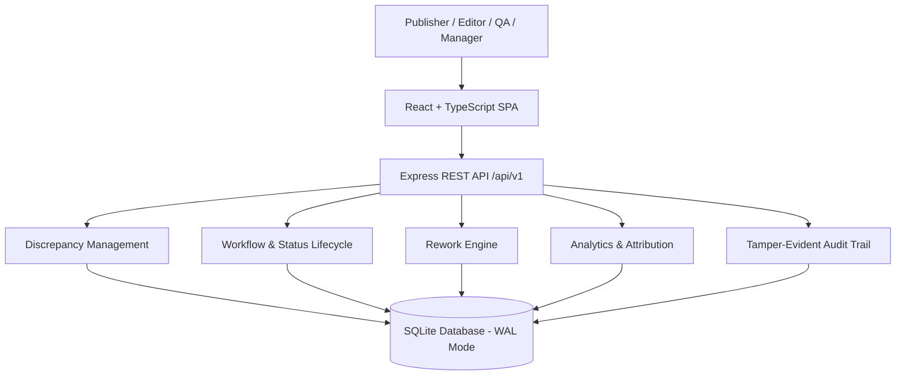

# Publisher–Editor Discrepancy Tracker

An internal operational discrepancy ledger, root-cause investigation, and rework attribution intelligence platform developed for **Taylor & Francis** scholarly publishing operations.

---

## 🏛️ Architecture Overview

The system is designed as a high-performance **modular monolith** with transactional persistence in **SQLite** (`WAL` mode with foreign keys enabled), a RESTful API backend, and an interactive **React + TypeScript SPA** implementing the **Academic Precision** design system.



---

## ✨ Features

- **Discrepancy Creation & Validation (FR-001..005):** Registration with auto-generated unique identifiers (`PED-000001`), mandatory validations, evidence linking, and manuscript association.
- **7-Stage Workflow Lifecycle (FR-014..019):** Visual step tracker connecting `NEW` → `TRIAGED` → `ASSIGNED` → `IN PROGRESS` → `RESOLVED` → `VERIFIED` → `CLOSED` with authorized reopening support.
- **Resolution Prerequisites (RULE-004):** Mandatory resolution notes and tagged root cause before closing/resolving.
- **Rework Effort Tracking (FR-020..025, RULE-006):** Captures contributor effort, enforces non-negative constraints (`hours >= 0`), and computes real-time `SUM(hours)` aggregations.
- **Executive Rework Analytics (FR-026..034):** Live KPI summary cards, time trends, journal rework ranking, and defect category Pareto shares.
- **Attribution Matrices (FR-022, RULE-010):** Editorial handling matrix paired with mandatory academic non-punitive governance disclaimers.
- **Admin Taxonomy Configuration (FR-054..057):** Management of categories, root causes, journal master data, and editor associations.
- **Tamper-Evident Audit Trail (FR-050..053, RULE-008):** Chronological logging of actor, timestamp, action, and JSON change deltas.
- **Interactive Multi-Filter Register (FR-035..043):** Full keyword search, multi-filters (journal, category, status, severity, priority), pagination, and filtered CSV export.

---

## 🚀 Quick Start

### Prerequisites
- **Node.js** (v20+ or v24+)
- **PowerShell** (Windows)

### Running the Application

Simply run the provided PowerShell startup script:

```powershell
.\run-app.ps1
```

This will automatically check the environment, compile production assets, initialize/seed the SQLite database, launch the server at `http://localhost:5000`, and open your default browser.

#### Optional PowerShell Script Flags
```powershell
# Reset database with clean baseline data
.\run-app.ps1 -Seed

# Force recompilation of frontend and backend
.\run-app.ps1 -Rebuild

# Run headlessly without opening browser
.\run-app.ps1 -OpenBrowser:$false
```

---

## 🧪 End-to-End Testing (Playwright)

Run the full automated E2E test suite covering all 10 core scenarios:

```bash
npm run test:e2e
```

All 10 scenarios test:
1. Discrepancy Registration, Validations & Auto PED-ID Generation
2. Search, Multi-Filter, Ledger Pagination & Filtered CSV Export
3. Complete Workflow Lifecycle & Reopen Path
4. Investigator Assignment & Assignment History
5. Root Cause Investigation & Tagging
6. Rework Effort Logging, Non-Negative Validation & Real-time Aggregation
7. Executive Dashboard KPIs & Drill-Downs
8. Attribution Matrices & Academic Non-Punitive Compliance (RULE-010)
9. Admin Taxonomy Management (Categories, Root Causes, Journals, Editor Associations)
10. System Audit Trail with JSON Delta Logging

---

## 🐳 Docker Deployment

The application is fully containerized as a lightweight, production-ready Alpine Linux image running Node.js 24 with native SQLite WAL support.

### Option A: Using Docker Compose (Recommended)

1. Start the container in detached mode with persistent volume storage:
   ```bash
   docker compose up -d --build
   ```

2. Access the application:
   - **Web UI & API:** [http://localhost:5000](http://localhost:5000)
   - **Healthcheck:** [http://localhost:5000/health](http://localhost:5000/health)

3. Stop the container:
   ```bash
   docker compose down
   ```

### Option B: Using the PowerShell Helper Script (Windows)

```powershell
# Build and run the container
.\docker-run.ps1

# View live container logs
.\docker-run.ps1 -Action logs

# Check container status
.\docker-run.ps1 -Action status

# Stop the container
.\docker-run.ps1 -Action down
```

### Option C: Using Docker CLI directly

```bash
# Build the Docker image
docker build -t tandf/publisher-editor-discrepancy-tracker:latest .

# Run the container with named volumes for database and attachment persistence
docker run -d \
  --name discrepancy-tracker-app \
  -p 5000:5000 \
  -v discrepancy_tracker_sqlite_data:/app/backend/data \
  -v discrepancy_tracker_uploads_data:/app/backend/uploads \
  --restart unless-stopped \
  tandf/publisher-editor-discrepancy-tracker:latest
```

### 💾 Container Persistence & Architecture Notes
- **Zero-Config Auto-Seed:** When the container boots for the first time with an empty database volume, it automatically runs database migrations (`schema.sql`) and seeds baseline taxonomy, users, and demonstration discrepancies.
- **SQLite WAL Mode:** SQLite operates in Write-Ahead Logging (`WAL`) mode with foreign key constraints enforced. SQLite requires local volume mounting (named Docker volumes or direct host filesystem mounts; avoid network CIFS/NFS mounts for SQLite locking integrity).
- **Single Container Monolith:** Express backend serves both the `/api/v1` REST APIs and the compiled React TypeScript SPA static assets from port 5000.

---

## 📚 Handover Documentation & Client Runbook

Comprehensive operational and architectural documentation has been prepared in the [`docs/`](./docs/) directory for the client team:

- **[Operational Runbook (`docs/RUNBOOK.md`)](./docs/RUNBOOK.md)**: Production deployment, container lifecycle, routine monitoring, backup/restore, hot WAL maintenance, and troubleshooting incident playbooks.
- **[Technical Architecture & Design (`docs/ARCHITECTURE_AND_DESIGN.md`)](./docs/ARCHITECTURE_AND_DESIGN.md)**: System design, relational ERD (13 tables), workflow state machine, and Academic Precision design specs.
- **[REST API Specification (`docs/API_SPECIFICATION.md`)](./docs/API_SPECIFICATION.md)**: Complete endpoint reference for `/api/v1` with JSON request/response models.
- **[QA & Verification Guide (`docs/TESTING_AND_VERIFICATION_GUIDE.md`)](./docs/TESTING_AND_VERIFICATION_GUIDE.md)**: Playwright test execution procedures, scenario matrix, and CI/CD pipeline examples.
- **[Client Handover Notes (`docs/CLIENT_HANDOVER_NOTES.md`)](./docs/CLIENT_HANDOVER_NOTES.md)**: Executive delivery summary, test user personas, architectural guarantees, and next steps.

---

## 📋 Requirements Traceability

Full mapping of Business Objectives (BR-001..009), Functional Requirements (FR-001..062), Business Rules (RULE-001..012), and User Stories (US-001..014) is documented in [`REQUIREMENTS_TRACEABILITY.md`](./REQUIREMENTS_TRACEABILITY.md).

---

## 📄 License

Proprietary — Taylor & Francis Group. All rights reserved.

