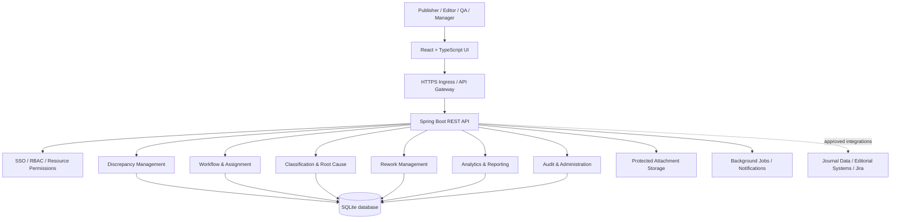
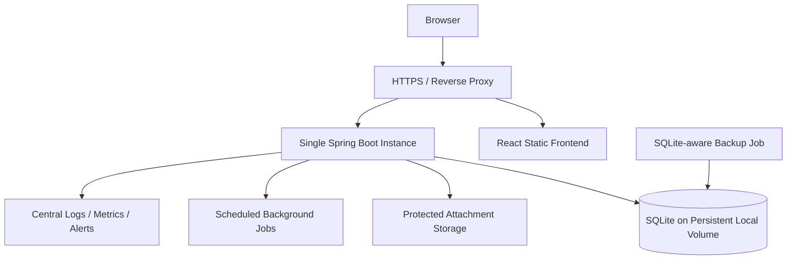

# Publisher–Editor Discrepancy Tracker
## Technical Architecture and Implementation Blueprint (SQLite)

**Organization:** Taylor & Francis  
**Status:** Proposed architecture; pending stakeholder and enterprise technology approval  
**Database choice:** SQLite (requested)  
**Application style:** Modular monolith, API-driven web application

## 1. Objectives and scope

Build an internal system that records discrepancies raised between publishers and editors, tags root causes, tracks rework, and analyzes which journals, editor associations, and defect categories contribute to the most rework. Editor association is **not** equivalent to proven fault; attribution must be defined and approved.

Core modules: discrepancy registration, classification, workflow, root cause investigation, rework tracking, dashboards, reporting, notifications, access control, and audit trail.

## 2. Recommended technology stack

| Layer | Technology | Purpose |
|---|---|---|
| Frontend | React + TypeScript + Vite | Browser application |
| UI | Material UI | Forms, tables, dialogs |
| Data fetching | TanStack Query | API state and caching |
| Backend | Java 21 + Spring Boot | REST APIs and business logic |
| Security | Spring Security + corporate OIDC SSO | Authentication and authorization |
| Database | **SQLite** | Transactional persistence |
| JDBC | Xerial SQLite JDBC | Database connection |
| ORM | Spring Data JPA + Hibernate Community SQLite Dialect | Data access |
| Schema migrations | Flyway with compatible SQLite support | Versioned schema |
| Evidence files | Protected object storage or directory | Attachments outside database |
| Dashboard | Apache ECharts + SQL aggregation | Trends and comparisons |
| API contracts | OpenAPI / Swagger | API documentation |
| Backend tests | JUnit 5, Mockito, REST Assured, Testcontainers where applicable | Unit and API testing |
| Frontend tests | Vitest + React Testing Library | Component testing |
| E2E tests | Playwright + TypeScript | Browser automation |
| Deployment | Docker, single application instance initially | Consistent hosting |
| Observability | OpenTelemetry and approved logging/monitoring | Operations |

**Alternative:** NestJS + TypeScript if approved by the enterprise team; Java/Spring Boot remains the reference choice.

## 3. Logical architecture



Use synchronous REST APIs for primary user actions. Use asynchronous workers for notifications, scheduled exports, and integrations as needed. Keep module boundaries clear without deploying separate microservices initially.

## 4. Main application modules

| Module | Responsibilities |
|---|---|
| Identity and access | SSO, role assignments, resource-level authorization |
| Discrepancy management | Create, edit, search, view, evidence |
| Workflow | Assignment, status transitions, resolution, reopen, closure |
| Classification | Defect category, severity, priority, root causes |
| Rework | Record individual work entries and calculate totals |
| Analytics | KPIs, trends, journal/editor/category comparisons |
| Notifications | Assignment alerts, reminders, escalations |
| Administration and audit | Configuration, history, data governance |

## 5. SQLite data model

| Table | Main columns / purpose |
|---|---|
| `app_users` | `id`, `external_user_id`, `display_name`, `email` |
| `roles`, `user_roles` | Permissions and assignments |
| `journals` | `id`, `journal_code`, `journal_name`, `active` |
| `editor_journals` | Editor-journal associations with validity dates |
| `defect_categories` | Category name and optional hierarchy |
| `discrepancies` | Title, description, journal, category, reporter, assignee, status, priority, severity, manuscript reference |
| `root_causes` | Root cause master list |
| `discrepancy_root_causes` | Root causes and investigation notes |
| `assignments` | Assignment and reassignment history |
| `rework_entries` | Discrepancy, performer, hours, work date |
| `attachments` | Object key, metadata, uploader |
| `status_history` | Workflow transition history |
| `audit_events` | Actor, action, timestamp, old/new values |
| `corrective_actions` | Preventive action tracking |

### 5.1 Starter SQLite migration

```sql
PRAGMA foreign_keys = ON;

CREATE TABLE journals (
    id INTEGER PRIMARY KEY,
    journal_code TEXT NOT NULL UNIQUE,
    journal_name TEXT NOT NULL,
    active INTEGER NOT NULL DEFAULT 1 CHECK (active IN (0,1))
);

CREATE TABLE app_users (
    id INTEGER PRIMARY KEY,
    external_user_id TEXT NOT NULL UNIQUE,
    display_name TEXT NOT NULL,
    email TEXT
);

CREATE TABLE defect_categories (
    id INTEGER PRIMARY KEY,
    category_name TEXT NOT NULL UNIQUE,
    active INTEGER NOT NULL DEFAULT 1 CHECK (active IN (0,1))
);

CREATE TABLE discrepancies (
    id INTEGER PRIMARY KEY,
    title TEXT NOT NULL,
    description TEXT NOT NULL,
    journal_id INTEGER NOT NULL REFERENCES journals(id),
    category_id INTEGER NOT NULL REFERENCES defect_categories(id),
    created_by INTEGER NOT NULL REFERENCES app_users(id),
    assigned_to INTEGER REFERENCES app_users(id),
    status TEXT NOT NULL DEFAULT 'NEW',
    severity TEXT,
    priority TEXT,
    manuscript_reference TEXT,
    created_at TEXT NOT NULL DEFAULT (strftime('%Y-%m-%dT%H:%M:%fZ','now')),
    updated_at TEXT NOT NULL DEFAULT (strftime('%Y-%m-%dT%H:%M:%fZ','now')),
    version INTEGER NOT NULL DEFAULT 0
);

CREATE TABLE rework_entries (
    id INTEGER PRIMARY KEY,
    discrepancy_id INTEGER NOT NULL REFERENCES discrepancies(id),
    performed_by INTEGER NOT NULL REFERENCES app_users(id),
    hours NUMERIC NOT NULL CHECK (hours >= 0),
    work_date TEXT NOT NULL,
    notes TEXT
);

CREATE INDEX idx_discrepancies_journal_status ON discrepancies(journal_id, status);
CREATE INDEX idx_discrepancies_created_at ON discrepancies(created_at);
CREATE INDEX idx_rework_discrepancy ON rework_entries(discrepancy_id);
```

This is **only a starter migration**. Add the remaining tables, status checks, indexes, uniqueness rules, and approved validations before production. Enable `PRAGMA foreign_keys=ON` **on each database connection**, not just during migration.

### 5.2 Example journal rework query

```sql
SELECT j.journal_code, j.journal_name,
       COUNT(DISTINCT d.id) AS discrepancy_count,
       COALESCE(SUM(r.hours), 0) AS total_rework_hours
FROM journals j
JOIN discrepancies d ON d.journal_id = j.id
LEFT JOIN rework_entries r ON r.discrepancy_id = d.id
GROUP BY j.id, j.journal_code, j.journal_name
ORDER BY total_rework_hours DESC;
```

Clarify whether reporting date filters refer to discrepancy creation, resolution, or rework-entry date.

## 6. SQLite-specific design decisions

- Enable WAL mode where suitable to improve reader/writer coexistence; SQLite still permits only one writer at a time.
- Configure a reasonable `busy_timeout`; keep write transactions short.
- Store the live `.db` file on persistent **local** storage, not ephemeral container storage or an unverified network filesystem.
- Begin with a **single backend instance** accessing the SQLite file; do not assume shared multi-host database access is safe.
- Use SQLite's supported backup API or `VACUUM INTO` with an operational backup and restore procedure; avoid naive live file copies.
- Enable foreign keys on every connection and test migration compatibility with SQLite.
- Store attachments separately from SQLite and scan/authorize downloads.
- Monitor lock contention, database growth, query plans, and report latency.
- Reassess the database if many simultaneous writers, multiple backend replicas, or large-scale analytics become necessary.

### 6.1 Illustrative Spring Boot properties

```properties
spring.datasource.url=jdbc:sqlite:./data/discrepancy_tracker.db
spring.datasource.driver-class-name=org.sqlite.JDBC
spring.jpa.database-platform=org.hibernate.community.dialect.SQLiteDialect
spring.jpa.hibernate.ddl-auto=validate
spring.jpa.show-sql=false
spring.flyway.enabled=true
```

Add a JDBC connection initialization mechanism for `PRAGMA foreign_keys=ON` and `busy_timeout`; configure WAL at database setup. Confirm compatible versions of Spring Boot, Xerial SQLite JDBC, Hibernate Community Dialects, and Flyway's SQLite support. These properties alone are **not** a complete production configuration.

## 7. REST API design (proposed)

Base path: `/api/v1`.

| Method | Endpoint | Description |
|---|---|---|
| POST | `/discrepancies` | Create |
| GET | `/discrepancies` | Search/filter |
| GET | `/discrepancies/{id}` | Details |
| PATCH | `/discrepancies/{id}` | Update permitted fields |
| POST | `/discrepancies/{id}/assignments` | Assign/reassign |
| POST | `/discrepancies/{id}/transitions` | Workflow transition |
| POST | `/discrepancies/{id}/root-causes` | Record cause |
| POST | `/discrepancies/{id}/rework` | Add effort entry |
| GET | `/discrepancies/{id}/history` | Audit/history |
| POST | `/discrepancies/{id}/attachments` | Initiate upload |
| GET | `/journals` | Permitted journal list |
| GET | `/categories` | Classifications |
| GET | `/analytics/summary` | KPIs |
| GET | `/analytics/by-journal` | Journal ranking |
| GET | `/analytics/by-editor` | Editor-associated metrics |
| GET | `/analytics/by-category` | Category analysis |
| GET | `/analytics/trends` | Time trends |
| POST | `/reports/exports` | Request export |

Example request:

```json
{
  "title": "Incorrect author affiliation",
  "description": "Affiliation differs from approved manuscript metadata.",
  "journalId": 101,
  "manuscriptReference": "DEMO-2026-001",
  "categoryId": 5,
  "severity": "MEDIUM",
  "priority": "P2"
}
```

Example response:

```json
{
  "id": 125,
  "reference": "PED-000125",
  "status": "NEW",
  "createdAt": "2026-10-20T10:30:00Z"
}
```

Never trust a client-supplied creator identity; derive it from the authenticated principal. API payloads, error formats, and permissions remain subject to contract approval.

## 8. Frontend pages

1. **Dashboard:** total/open/resolved discrepancies, rework hours, trends, top journals and categories.
2. **Discrepancy register:** searchable, filterable, paginated records.
3. **Create discrepancy:** validated form, journal lookup, evidence attachments.
4. **Discrepancy details:** assignment, classification, root causes, resolution, history.
5. **Rework tracking:** effort entries, contributor and date.
6. **Analytics:** drill-down by journal, editor association, root cause, and category.
7. **Reports:** authorized filtered export.
8. **Administration:** categories, permissions, workflow and journal references.

## 9. Suggested repository structure

```text
publisher-editor-tracker/
├── backend/
│   ├── src/main/java/com/company/ped/
│   │   ├── config/
│   │   ├── security/
│   │   ├── common/
│   │   ├── discrepancy/
│   │   ├── workflow/
│   │   ├── classification/
│   │   ├── rework/
│   │   ├── analytics/
│   │   ├── notification/
│   │   ├── attachment/
│   │   └── audit/
│   ├── src/main/resources/db/migration/
│   └── src/test/
├── frontend/src/
│   ├── app/
│   ├── components/
│   ├── features/
│   ├── pages/
│   ├── services/
│   └── types/
├── tests/
│   ├── playwright/
│   └── api/
├── infrastructure/
└── docs/
```

## 10. Security and governance

- Corporate OIDC SSO; validate access tokens server-side.
- Role-based **and resource-level** authorization; restrict journal-level access.
- TLS, encrypted persistent storage, secure secret management.
- Protect uploads with size/type validation, malware scanning, and download authorization.
- Immutable or tamper-evident audit history.
- Apply data minimization, retention, and access restrictions to manuscript and employee-related data.
- Apply permission checks to dashboards, aggregates, and exports, not just record screens.
- Distinguish discrepancy reporter, associated editor, resolver, and verified root-cause responsibility.

## 11. Deployment and operations



Environments: Local, DEV, QA/SIT, UAT, Production. Use CI/CD for tests, scans, schema migration checks, deployment, and rollback. Kubernetes is not required for the MVP.

## 12. Testing strategy

| Layer | Tools | Focus |
|---|---|---|
| Unit | JUnit, Mockito, Vitest | Business rules and components |
| API | REST Assured | Contracts, validation, authorization |
| Database integration | SQLite test database | Foreign keys, migrations, locking, concurrency |
| UI/E2E | Playwright + TypeScript | Core workflows and role behavior |
| Security | Automated scans and targeted testing | Authorization, data leakage, exports |
| Analytics | SQL reconciliation tests | Counts, effort totals, filters, date boundaries |
| Performance | Approved load-testing tool | Write contention and reporting response times |

Priority E2E scenarios: create discrepancy, validation errors, role restrictions, assign/resolve/reopen, root cause changes, rework entry calculations, analytics drill-down, export authorization, audit history.

## 13. Delivery plan (illustrative, not a commitment)

| Weeks | Workstream |
|---|---|
| 1–2 | Confirm requirements, attribution model, UI/UX |
| 2–3 | Repository, architecture, SSO, SQLite migrations, CI |
| 3–6 | Discrepancy CRUD, classifications, journal associations |
| 5–8 | Workflow, root causes, rework, audit |
| 7–10 | Dashboard, filters, exports |
| 9–12 | Automated QA, security, performance, UAT, release |

Suggested team: product owner/business analyst, technical lead, 1–2 backend engineers, 1–2 frontend engineers, QA automation engineer, part-time DevOps and UX.

## 14. MVP priorities

1. SSO and authorized access.
2. Discrepancy registration and searchable list.
3. Assignment, investigation, resolution, closure, and audit.
4. Root cause tagging.
5. Rework effort entry and aggregation.
6. Dashboard by journal, editor association, and defect category.

Defer advanced notifications, Jira integration, AI insights, and enterprise-wide BI until approved.

## 15. Decisions to confirm

- Standalone application versus extension of an existing Taylor & Francis system.
- Authoritative journal and editor identity sources.
- Manual defect entry versus import/integration.
- Precise definition of discrepancy, recurrence, and rework.
- Attribution model: reporter vs related editor vs investigator vs confirmed responsible party.
- Required status transitions and closure rules.
- Data volumes, concurrent writers, hosting restrictions, retention, backup and recovery targets.
- Required dashboards, export formats, report date semantics, and access rules.
- Corporate approved versions and deployment platform.

---

**Architecture decision:** SQLite is the selected database for the initial design. Validate its concurrency and operational limits before approving enterprise production use.
