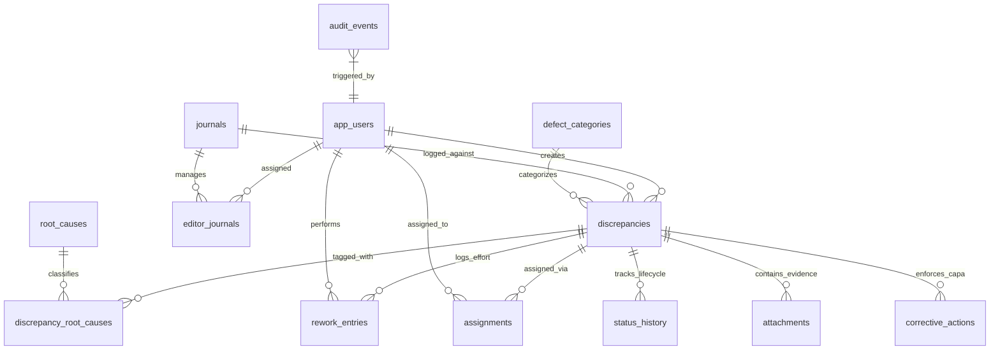
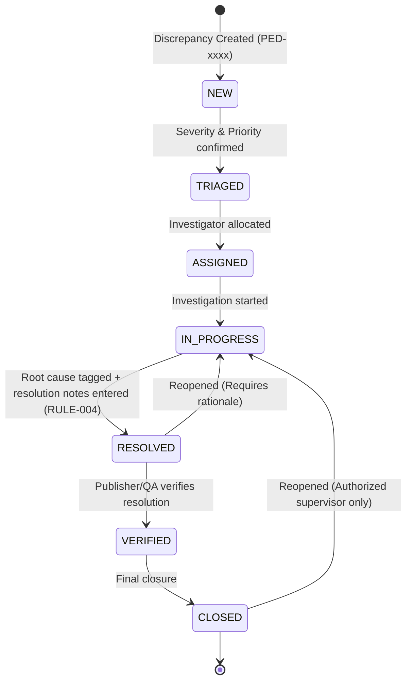

# Technical Architecture & Design Document

**System:** Taylor & Francis Publisher–Editor Discrepancy Tracker  
**Document Code:** ARCH-PEDT-001  
**Target:** Client Engineering Teams, Architects & Technical Leads  

---

## 1. Architectural Principles & Vision

The system is engineered as an enterprise-grade **modular monolith** optimized for academic editorial operations:

1. **Deterministic Persistence:** Built around SQLite in Write-Ahead Logging (`WAL`) mode, providing ACID guarantees, sub-millisecond query execution, and atomic transaction durability without the operational overhead or network latency of an external database cluster.
2. **Unified Deployment Artifact:** A single multi-stage Docker container serves both the high-performance Express REST API backend and the static pre-compiled React Single Page Application (SPA).
3. **Decoupled Service Layer:** Core business logic (discrepancy validation, status transitions, rework calculation, and tamper-evident auditing) is strictly encapsulated into dedicated domain services.
4. **Academic Precision Design System:** Bespoke user experience adhering to Taylor & Francis editorial branding—deep corporate navy (`#0f2942`), crisp typographic scale, high-density data tables, and non-punitive governance disclaimers.

```mermaid
flowchart TB
    subgraph ClientBrowser [Browser Client: React 18 + TypeScript SPA]
        UI[Academic Precision UI]
        Router[View Router]
        State[App State & Notification Center]
        APIClient[REST API Client /api/v1]
        UI --> Router
        Router --> State
        State --> APIClient
    end

    subgraph Container [Docker Container: Node.js 24 Alpine]
        subgraph WebServer [Express Application Server]
            StaticMiddleware[Frontend Static Middleware]
            HealthRouter[/health]
            APIRouter[/api/v1]
        end

        subgraph ServiceLayer [Business Logic Domain Services]
            DiscService[discrepancyService]
            WFService[workflowService]
            RWService[reworkService]
            ANService[analyticsService]
            AUDService[auditService]
        end

        subgraph Persistence [Embedded SQLite WAL Engine]
            DB[(discrepancy_tracker.db)]
            WAL[(WAL Journal)]
            Uploads[(Evidence File Storage)]
        end
    end

    APIClient --> APIRouter
    StaticMiddleware --> UI
    APIRouter --> DiscService
    APIRouter --> WFService
    APIRouter --> RWService
    APIRouter --> ANService
    APIRouter --> AUDService
    DiscService --> DB
    WFService --> DB
    RWService --> DB
    ANService --> DB
    AUDService --> DB
    DB -.-> WAL
```

---

## 2. Relational Data Architecture

The schema contains 13 relational tables governed by strict foreign keys and check constraints.

### 2.1 Database Schema Diagram



### 2.2 Table Inventory

| Table Name | Purpose | Key Constraints |
| :--- | :--- | :--- |
| `app_users` | User accounts, roles, SSO external identity | Unique email and external user ID |
| `journals` | Journal master records (ISSN, discipline, code) | Unique 3-4 letter journal code |
| `editor_journals` | Editor-to-journal management assignments | Composite unique (`editor_id`, `journal_id`) |
| `defect_categories`| Hierarchical taxonomy of operational defects | Unique category code, self-referencing parent |
| `root_causes` | Root cause taxonomy for discrepancy attribution | Unique cause code, categorized taxonomy |
| `discrepancies` | Core discrepancy ledger records | Unique `reference_id` (`PED-000001`), foreign keys |
| `discrepancy_root_causes` | Many-to-many junction between defects and causes | Composite PK (`discrepancy_id`, `root_cause_id`) |
| `rework_entries` | Contributor rework effort attribution | `hours >= 0.0` check constraint |
| `assignments` | Historical and current investigator assignments | Foreign keys to `discrepancies` & `app_users` |
| `status_history` | Complete historical state transition log | Immutable transition audit |
| `audit_events` | Tamper-evident operational audit ledger | Append-only, JSON before/after value deltas |
| `attachments` | Evidence files, logs, and screenshots | Foreign keys, metadata and MIME storage |
| `corrective_actions` | CAPA remediation records | Preventative action tracking |

---

## 3. Discrepancy Lifecycle & State Machine

The workflow service enforces a 7-stage state machine with strict transition guards and prerequisite validations.



### Transition Prerequisites & Rules
- **RULE-001 (Validations):** Mandatory title, description, journal, category, severity, and priority upon creation.
- **RULE-004 (Resolution Gate):** Cannot move to `RESOLVED` unless at least one root cause is tagged and substantive resolution notes are recorded.
- **RULE-005 (Reopen Justification):** Moving backwards from `RESOLVED` or `CLOSED` requires an explicit, audited reopen reason.
- **RULE-006 (Rework Logging):** Rework entries enforce non-negative hours (`hours >= 0`).

---

## 4. Academic Precision Design System

The frontend implements the **Academic Precision** UI specification:

- **Typography:** Inter & system fonts with tabular numbers (`font-mono` / `tabular-nums`) for currency and hours.
- **Color Palette:**
  - `Surface Dark`: `#0f2942` (Primary Taylor & Francis header)
  - `Accent Navy`: `#1e3a8a` / `#2563eb`
  - `Canvas Neutral`: `#f8fafc`
  - `Border Neutral`: `#e2e8f0`
- **State Badges:** Color-coded badges for statuses (`NEW`: Amber, `TRIAGED`: Blue, `IN_PROGRESS`: Indigo, `RESOLVED`: Emerald, `CLOSED`: Slate).
- **Non-Punitive Attribution Disclaimer (RULE-010):** Embedded persistently across all rework dashboards and attribution matrices to prevent punitive misuse of operational data.
